# Daybreak — HELLFEST 2027 « Le Centième Feu »

> **Concept indépendant et non officiel.** L'édition anniversaire 2027 décrite ici est **entièrement
> fictive**. Hellfest n'a pas commandé, validé ni produit ce concept. Aucun contenu protégé
> (logo, affiche, photo, vidéo, musique, slogan, code graphique) des organisations étudiées
> n'est repris. Voir [la colonne de transparence](#8-ce-qui-est-réellement-implémenté) et [docs/PROCESS.md](docs/PROCESS.md).

**Nom de code du collectif :** Daybreak
**Prototype :** `hellfest-2027/` — site statique, sans dépendance, exécutable en local
**État :** prototype fonctionnel ; code publié sur GitHub

---

## Sommaire

1. [Le concept](#1-le-concept)
2. [Statut du prototype](#2-statut-du-prototype)
3. [Qui a réalisé ce projet](#3-qui-a-réalisé-ce-projet)
4. [Le brief reçu et ses contraintes](#4-le-brief-reçu-et-ses-contraintes)
5. [Les cinq organisations comparées](#5-les-cinq-organisations-comparées)
6. [Pourquoi Hellfest](#6-pourquoi-hellfest)
7. [Le concept final](#7-le-concept-final)
8. [Ce qui est réellement implémenté](#8-ce-qui-est-réellement-implémenté)
9. [Captures du prototype](#9-captures-du-prototype)
10. [Technologies et structure du dépôt](#10-technologies-et-structure-du-dépôt)
11. [Ressources, sources et licences](#11-ressources-sources-et-licences)
12. [Installer et lancer](#12-installer-et-lancer)
13. [Vérifications exécutées](#13-vérifications-exécutées)
14. [Contexte de réalisation](#14-contexte-de-réalisation)
15. [Bilan honnête](#15-bilan-honnête)

---

## 1. Le concept

**HELLFEST 2027 — « Le Centième Feu »** est une expérience web imaginée pour un centième
anniversaire de festival. Le pitch tient en une phrase :

> Hellcity ne compte pas les années. Elle compte les feux. Pour la centième fois, les Portes
> s'ouvrent à l'envers : on entre par la dernière scène, on descend, et on ne remonte pas les
> mêmes qu'on est descendu.

Le prototype ne raconte pas cette édition en la décrivant : il propose **trois entrées dans le
même invariant**, et il faut les traverser toutes pour atteindre la dernière porte.

| Mode | Adresse | Nature | Durée visée |
|---|---|---|---|
| **A — La Descente** | `#/descente` | Expérience immersive, verticale, jouée | 8 à 12 min |
| **B — Archives de Minuit** | `#/archives` | Récit par la durée, horizontal, contemplatif | 6 à 10 min |
| **C — Pratique** | `#/pratique`, `#/programme` | Accès direct à l'information | 1 à 3 min |

- **Mode A** : six scènes, six rites, six « étincelles ». La Fosse (scène finale) reste verrouillée
  tant que les six étincelles ne sont pas récoltées.
- **Mode B** : huit chapitres de 2006 à 2027, une frise horizontale, un emblème SVG généré par
  chapitre, une ambiance sonore optionnelle, et un « mur local » où le visiteur peut déposer un
  souvenir — stocké dans son navigateur, jamais transmis.
- **Mode C** : programme par jour et par scène, « Mon festival » (programme personnel local), passes
  et panier **simulés**, lieux, accès et transports, modalités de participation, accessibilité, FAQ.

## 2. Statut du prototype

| Point | État réel |
|---|---|
| Fonctionnel | Oui — 2 382 lignes de source, six routes, trois modes |
| Lancement | `node hellfest-2027/serve.js` — aucune installation, aucun build |
| Dépendances | **Zéro** — HTML, CSS et JavaScript classique, sans framework ni paquet |
| Réseau à l'exécution | **Zéro requête** — polices embarquées, aucune ressource distante |
| Données | Uniquement `localStorage` (programme personnel, fragments, préférences) |
| Compte / paiement | Aucun. Le panier est une simulation explicitement étiquetée |
| Publication | **Aucune.** Rien n'a été mis en ligne ; le dossier n'est pas encore un dépôt Git |
| Réutilisation | Les polices sont redistribuables (SIL OFL 1.1) ; le reste est du code original |

Le prototype est **fictif, indépendant et non officiel**. L'organisation choisie n'a ni
commandé, ni relu, ni cautionné ce travail ; aucune de ses personnes réelles n'est citée, mise en
scène ou imitée.

## 3. Qui a réalisé ce projet

**Ce projet a été réalisé intégralement par une intelligence artificielle, après réception
d'une demande.** Tout le code du prototype — et cette documentation — a été écrit par
l'assistant. L'humain a fourni le brief, puis a demandé la documentation ; il n'a ni écrit, ni
relu, ni corrigé de code.

| Élément | Valeur |
|---|---|
| Assistant | **MiniMax-M3.1-Flash** (MiniMax) |
| Version exposée | `MiniMax-M3.1-Flash`, knowledge cutoff **février 2026** |
| Runtime d'exécution | **Qoder Desktop** (agent), build win32 `10.0.26300`, x64 |
| Identité servie | Nom et version exposés par le runtime ; aucun identifiant de build serveur plus fin n'est disponible |
| Outils | Outils de fichier, de recherche et d'exécution du runtime ; `node --check` ; `curl` ; un script Python pour les réécritures de texte |
| Génération d'images | **Aucune.** Tous les visuels du prototype sont générés par le code (dégradés CSS, SVG en ligne, Canvas). `ImageGen` n'a volontairement pas été utilisé : le brief interdit de reproduire des visuels protégés, et le procédural est à la fois plus sûr et entièrement redistribuable |
| Génération d'audio | **Aucune.** Le son est synthétisé à l'exécution par l'API Web Audio (oscillateurs, filtres, bruit façonné). Aucun fichier audio n'a été échantillonné ou livré |

Le nom de code **Daybreak** est le nom de code du collectif de travail qui a produit ce
prototype ; il ne désigne aucune entité existante.

## 4. Le brief reçu et ses contraintes

La demande reçue était un **brief de défi web créatif (« Live Experience 2027 — Creative Web
Experience Challenge — 01 »)**, assorti d'une limite de temps de 90 minutes et d'un fichier
d'attachement. Le brief demandait :

| Contrainte du brief | Comment elle est respectée |
|---|---|
| Étudier **cinq** organisations à partir de leurs sites officiels, puis **choisir seul** | Comparaison des cinq documentée en [§5](#5-les-cinq-organisations-comparées) ; le choix est argumenté en [§6](#6-pourquoi-hellfest) |
| Inventer une édition 2027 **entièrement fictive**, distincte de toute édition réelle | « Le Centième Feu », 19–22 août 2027 — l'édition 2027 réellement annoncée par l'organisation se tient du 17 au 20 **juin** 2027 et n'est pas reprise |
| Concevoir une **expérience**, pas une page d'atterrissage | Trois modes d'entrée distincts, dont un mode principal jouable |
| **Au moins trois modes de découverte** | A, B et C ci-dessus |
| Respecter la **marque** sans copier les assets protégés | Typographie, palette et graphisme **entièrement originaux** ; aucun logo, affiche, photo, vidéo, musique, slogan ou code graphique des organisations étudiées |
| Fournir l'information **pratique** | Programme, lieux, accès, participation, accessibilité, FAQ, passes simulées |
| **Accessibilité** et **multi-écran** | Clavier, focus visibles, `aria-live`, contraste renforcé, mouvement réduit, cibles tactiles, navigateur mobile ; testé à 390 / 768 / 1 440 px |
| Livrer un prototype **réellement lançable** avec sources et instructions | `hellfest-2027/`, documenté en [§12](#12-installer-et-lancer) |
| **Ne jamais** simuler une vraie transaction, collecter de données personnelles, inventer des partenariats ou présenter le prototype comme une annonce réelle | Panier étiqueté « simulation », aucun compte, aucune donnée transmise, bandeau d'avertissement permanent |
| **Journaliser** honnêtement le modèle, l'environnement, les outils, la durée, le coût et les tests | [§13](#13-vérifications-exécutées) et [§14](#14-contexte-de-réalisation) |

### 4.1 La demande reçue est fictive par construction : où passe la frontière

Le brief reçu est un **brief de défi créatif**, pas une commande d'organisation : il demande
de choisir une organisation parmi cinq, de lui inventer une édition 2027, puis de la
réaliser en expérience web. La « demande » qui a produit ce prototype est donc **fictive
par construction** — elle n'émane pas de l'organisation retenue, et personne n'a commandé
cette édition. Le site est un prototype de démonstration, pas une annonce.

Pour que la confusion n'existe pas, voici exactement où passe la frontière entre ce qui est
**établi** et ce qui est **fictif**.

| Élément | Statut | Ce qui existe réellement |
|---|---|---|
| Le brief du défi | **Réel** | Les contraintes listées ci-dessus, reçues avec une limite de 90 minutes |
| Les cinq organisations étudiées | **Réel** | Des pages publiques lues en ligne le 27 octobre 2026 — aucune donnée privée, aucun compte |
| Hellfest en tant qu'organisation | **Réel** | Festival créé en 2006 à Clisson ; l'édition 2027 réellement annoncée se tient du 17 au 20 **juin** 2027 |
| L'édition « Le Centième Feu » (19–22 août 2027) | **Fictif** | Aucun festival, aucune affiche, aucun billet, aucun partenaire de ce nom n'existe |
| Le programme (68 créneaux, 4 jours, 6 scènes) | **Fictif** | Aucun nom d'artiste réel : les groupes et les scènes sont inventés |
| Les dix lieux de Hellcity | **Fictif** | Toponymes inventés ; seuls des repères publics réels (gare, parking, réseau) sont cités |
| Les tarifs des passes | **Fictif** | Panier de démonstration étiqueté « simulation » : ni paiement, ni compte, ni donnée transmise |
| Les six rites du mode A | **Réel, en tant que code** | Le prototype implémente réellement la chaîne décrite en [§7](#7-le-concept-final) |
| Les captures de [§9](#9-captures-du-prototype) | **Réel** | Captures d'écran prises dans un navigateur réel, sur le prototype livré dans ce dépôt |

Deux précisions utiles :

- **La date a été déplacée exprès.** L'édition 2027 officiellement annoncée en juin n'est pas
  reprise : le prototype situe son édition imaginaire en août, pour ne pas être confondu avec
  une communication réelle.
- **Aucun élément de marque n'est emprunté.** Typographie, palette, emblèmes, noms de lieux et
  rédaction sont originaux. Les trois polices livrées sont libres (SIL OFL 1.1) ; aucun logo,
  affiche, photo, vidéo, musique, slogan ou code graphique des organisations étudiées n'a été
  repris. Voir [§11](#11-ressources-sources-et-licences).
- **Le statut de chaque information est marqué dans le produit lui-même.** La vue
  « La Colonne » de [§9](#9-captures-du-prototype) affiche la séparation « Fiction 2027 » /
  « Vérifié » / « Simulation » ; les pages pratiques signalent chaque bloc.

## 5. Les cinq organisations comparées

**Méthode.** Consultation en ligne des sites officiels le **27 octobre 2026** : requêtes HTTP
directes, lecture du HTML, des feuilles de style, des plans de site et des communiqués de presse
officiels. Lorsque le contenu d'une page était rendu côté client ou vide, d'autres sources
publics ont été mobilisées (encyclopédie, presse, archives web).

### 5.1 Tableau de synthèse

| Organisation | État d'accès | Méthode | Limite rencontrée |
|---|---|---|---|
| **Shen Yun** | Partiel | `shenyun.org` redirige ; corps des pages rendu côté client ; extraction depuis les communiqués officiels, le JSON de la FAQ et les variables CSS | La programmation 2027 renvoie « no results » |
| **Cirque du Soleil** | Partiel | Plan de site de 217 URL, variables CSS brutes, métadonnées des spectacles, kit de presse officiel | Les pages spectacles sont pratiquement vides de contenu éditorial |
| **Country Jam** | Oui (en direct) | Récupération directe ; le site sert encore le contenu 2025 | Statut 2026 signalé comme non vérifié face au site officiel |
| **Hellfest** | Oui | Récupération directe de `/en`, `/en/experience-1`, FAQ, CSS et PNG de logo | — |
| **Lollapalooza Stockholm** | **Non (en direct)** | Le site en ligne est une page de garde ; reconstruction à partir d'instantanés Wayback (2022, 2023, 2026) | Ni programmation, ni billetterie, ni historique à inspecter |

### 5.2 Faits vérifiés, interprétations, inaccessibles

**Faits vérifiés** (consultés en ligne le 27 octobre 2026, source indiquée) :

- Hellfest est un festival créé en **2006** à **Clisson (Loire-Atlantique)**, à la suite de l'arrêt de
  Furyfest. — *Source : hellfest.fr, page « The Festival » ; encyclopédie.*
- Les **six scènes** : Mainstages 1 et 2, Warzone, Valley, Altar, Temple, plus Hellstage à
  l'entrée. — *Source : hellfest.fr, grille de programmation officielle.*
- Le festival s'est **arrêté en 2020 et 2021**, puis a repris en **2022** ; il revendique plusieurs
  centaines de milliers de spectateurs par édition. — *Source : hellfest.fr, page d'accueil ; encyclopédie.*
- Il existe une **« Hellcity Square »** (marché, ATM, tatouage) et une communauté de fidèles
  auto-désignée **« Hellbangers »**. — *Source : hellfest.fr, page « Experience » ; encyclopédie.*
- Hellfest a annoncé de son côté une **édition 2027 du 17 au 20 juin 2027 à Clisson, avec 300+
  artistes**. — *Source : hellfest.fr, page d'accueil.*
- Le site officiel est **une application unique**, servie **à l'identique** pour les agents
  utilisateur mobile et desktop (347 784 octets dans les deux cas), sans version mobile séparée ;
  la feuille de style contient **99 règles `@media`** avec des points de rupture à **768, 1 440 et
  1 500 px**. — *Source : hellfest.fr, feuille `entry.DRSX6o_s.css`, relevée le 27 octobre 2026.*

**Interprétations** (lecture personnelle, à ne pas confondre avec des faits) :

- Hellfest est l'organisation dont l'identité **tient le plus dans la durée** : une ville, une
  communauté nommée, des scènes qui changent de visage selon l'heure. C'est ce qui rend
  « Archives de Minuit » — un récit par la durée — narrativement justifié plutôt qu'arbitraire.
- Le fait que le site officiel **n'ait aucune règle `prefers-reduced-motion`** fait du réglage
  « mouvement réduit » du prototype une réponse à un manque réel, et non à une mode.
- Le volume visuel du festival (scènes, foules, chaleur, nuit) se prête à un rendu **procédural**
  — dégradés, SVG, particules — sans reproduire un seul visuel protégé.

**Non consulté / inaccessible** (déclaré dans le produit, page « La Colonne ») :

- Les données internes de l'organisation.
- La **programmation 2027 détaillée** et le récapitulatif officiel des artistes.
- Les **chiffres de fréquentation rapprochés** et vérifiés.
- Toute **inspection visuelle** du rendu officiel sur mobile ou desktop : la comparaison
  mobile/desktop porte **uniquement sur la structure technique** (requête HTTP, feuille de style,
  points de rupture, poids du payload). Aucune capture d'écran ni comparaison visuelle du site
  officiel n'a été réalisée.
- L'**état 2026** de Country Jam, non confirmé par son site officiel.

## 6. Pourquoi Hellfest

Quatre raisons, dans l'ordre de poids pour l'expérience imaginée :

1. **Potentiel créatif.** Un festival dont les scènes changent de nature (concert, metal,
   World's End, rock indé, zone oscura,''') fournit six **rites** naturellement distincts —
   scanner, viseur, fouille, souffle, frappe, bougie — au lieu d'un puzzle unique répété.
2. **Public.** Un public de festival heavy metal n'est pas un public de « landing page » : il
   attend une **découverte par l'effort**, pas par la lecture. La Descente est jouée, elle se
   mérite.
3. **Besoins servis.** L'information pratique y est critique (transport, camping, sécurité,
   accessibilité, etc.). Le mode C existe pour elle, et l'expérience ne la sert pas en second
   plan.
4. **Pertinence pour le récit « Archives de Minuit ».** Un festival qui traverse vingt et un
   ans se raconte **par la durée**. C'est ce qui rend le mode B radicalement différent du mode A
   plutôt que sa réécriture.

Les quatre autres candidats ont été écartés pour des raisons explicites : Shen Yun et Cirque
du Soleil ont des pages peu exploitables pour un récit de festival metal, Country Jam n'expose pas
son état actuel, et Lollapalooza Stockholm n'était pas inspectable en ligne.

## 7. Le concept final

### 7.1 Le récit

Le prototype part d'un invariant vérifiable dans la documentation du festival : **la Fosse, au
centre, s'ouvre en dernier**. Le concept le prend au sérieux et l'inverse — on entre par la
dernière scène et on descend.

Le « Centième Feu » n'est pas une internationalisation du Centième anniversaire : c'est un feu qu'on **descend**,
et qui ne se rejoue pas. Le mode A raconte donc une **traversée descendante** ; le mode B
raconte la **même histoire par les années** ; le mode C donne le **plan** — sans-storytelling
volontairement, pour qui veut la vérité pratique d'abord.

### 7.2 La direction artistique

- **Palette** : noir de scène, ambre, orange braise, os. Aucune couleur de Hellfest officielle
  n'est reprise comme telle ; la palette est **partagée** entre la typographie condensée et les
  dégradés de scène.
- **Typographie** : Rye (titres, ambiance western), Oswald (navigation, étiquettes, horaires),
  Barlow (textes courants). Trois familles Google Fonts, sous-ensembles latins, embarquées.
- **Graphisme** : 100 % procédural. Emblèmes SVG générés par chapitre, dégradés CSS par scène,
  système de particules Canvas pour les braises de l'accueil, grain SVG `feTurbulence` en fond.
- **Son** : synthèse Web Audio (deux voix, filtre, bruit, compresseur), **éteinte par défaut** —
  aucun son n'est supposé acquis.

### 7.3 Parcours et interactions

| Moment | Interaction | Récompense |
|---|---|---|
| Accueil | Titulaire en dégradé, fait de feu, choix des trois modes | Orientation |
| Mode A · scène 1 | Scanner le pass (clic ou Entrée/Espace) | Étincelle 1 |
| Mode A · scène 2 | Viser trois balises (souris ou clavier) | Étincelle 2 |
| Mode A · scène 3 | Trouver les trois affiches abrégées parmi douze | Étincelle 3 |
| Mode A · scène 4 | Tenir le souffle jusqu'à la levée de la brume | Étincelle 4 |
| Mode A · scène 5 | Frapper trois fois dans le cercle | Étincelle 5 |
| Mode A · scène 6 | Retourner les cinq bougies | Étincelle 6 |
| Mode A · la Fosse | Récapitulatif des six scènes, porte ouverte | Final |
| Mode B | Frise horizontale, 8 chapitres, clavier, son optionnel | Mémoire |
| Mode B | Déposer un fragment sur le mur local | Trace personnelle |
| Mode C | Programme, filtres, « Mon festival », panier simulé | Information |

### 7.4 Décisions importantes et changements de direction

Décisions **prises en cours de route**, consignées ici parce qu'elles ont modifié le résultat
final — pas pour reconstituer un raisonnement interne, mais pour ce qu'elles ont changé :

| Décision | Conséquence sur le résultat |
|---|---|
| Le mode B a d'abord été conceived comme une **galerie verticale** de cartes | Remplacé par une **frise horizontale** : la durée se traverse, elle ne se lit pas. Le mode B est devenu radicalement différent du mode A au lieu d'en être une variante. |
| La détection de la frappe rythmique dépendait de `requestAnimationFrame` | Réécrite sur l'horloge : le rite reste correct même quand l'onglet est en arrière-plan et que l'animation est suspendue. Une variante à cible fixe a été ajoutée pour le mode « mouvement réduit ». |
| Le bandeau d'avertissement était un simple bandeau | Il est devenu un **élément permanent de l'interface**, présent sur toutes les routes et lien vers la méthode. |
| LesTests précoces (boutons morts, débordements) ont été faits dans un onglet caché | La méthode a été corrigée (attentes actives, défilement instantané) : plusieurs « échecs » observés étaient des artefacts de mesure, pas des défauts du produit. |
| La revue visuelle était impossible avec l'onglet disponible | Elle a été rendue possible par un second passage, avec un Chrome headless piloté en CDP — d'où les captures de [§9](#9-captures-du-prototype). |

## 8. Ce qui est réellement implémenté

### 8.1 Fonctionnel

- **Six routes** : `#/`, `#/descente`, `#/archives`, `#/pratique`, `#/programme`, `#/colonne`,
  avec titre de document, `aria-current`, focus transféré, ancres internes et route
  `route + ancre` fonctionnelles.
- **Mode A** : sept scènes, six rites jouables, six étincelles, barre de progression avec
  `role="progressbar"`, verrou de la Fosse avec message d'erreur, piège de focus dans la
  superposition, fermeture par `Échap`.
- **Mode B** : huit chapitres, emblèmes SVG générés, frise à défilement horizontal, navigation
  clavier (`←`, `→`, `Début`, `Fin`, `Page↑/↓`), ambiance sonore optionnelle, mur local de
  fragments (`localStorage`, effaçable, bouton désactivé quand le mur est vide).
- **Mode C** : programme de **68 rendez-vous** (14 / 18 / 21 / 15 par jour) sur 4 jours et 6
  scènes, filtres par scène, « Mon festival » persisté localement, **4 passes simulées** et
  panier de démonstration, 10 lieux fictifs, accès et transports, modalités de participation,
  accessibilité, FAQ.
- **La Colonne** : trois colonnes — ce qui est vérifié (avec sources), ce qui est inventé, ce qui
  n'a pas pu être consulté — plus les réglages de confort.
- **Confort** : mouvement réduit (`prefers-reduced-motion` + réglage applicatif persistant),
  contraste renforcé (`prefers-contrast` + réglage applicatif), son éteint par défaut.

### 8.2 Simulé ou fictif — et c'est écrit dans le produit

| Élément | Nature | Mention visible dans l'interface |
|---|---|---|
| Passes et panier | **Simulation** — aucun paiement, aucun compte, aucune donnée transmise | Badge « SIMULATION — AUCUN PAIEMENT », bouton « VALIDER (SIMULATION) », panier « PANIER DE DÉMONSTRATION » |
| Programme, groupes, horaires | **Fiction** — 42 groupes qui n'existent pas | Bandeau « ENTIÈREMENT FICTIF », mention « tous les noms et horaires sont fictifs » |
| Dates, lieu, fréquentation | **Fiction** — 19–22 août 2027, Clisson, 180 000 | Mention « (FICTIVES) » sous chaque donnée |
| Fosse, ses règles, le Centième Feu | **Fiction** — création du prototype | Mention explicite en pied de scène |
| Témoignages des chapitres | **Fiction** — sauf deux chapitres sourcés | Étiquette par chapitre : « vérifié » ou « fiction » |
| Son | **Synthèse abstraite**, pas une ambiance réelle | Contrôle « ambiance sonore », éteint par défaut |

### 8.3 Inachevé ou absent

- **Le marqueur du rite rythmique (Autel) n'est pas visible à l'écran.** Le calcul de la frappe est
  correct, mais la position dessinée du marqueur est calculée à partir d'une horloge incompatible
  avec celle du test de frappe : le marqueur est rendu **hors de la piste** (mesuré : `left: -163 %`
  pour une piste de 519 px). Le rite reste donc jouable « à l'aveugle » ou via la variante à
  cible fixe du mode mouvement réduit, mais le joueur ne voit pas où frapper. Ce défaut a été
  trouvé **pendant la rédaction de cette documentation**, n'a **pas été corrigé** (la consigne de
  cette passe était de ne pas modifier le prototype), et est détaillé dans
  [docs/PROCESS.md](docs/PROCESS.md#6-défauts-trouvés-et-corrections).
- Aucun export, aucun envoi, aucun partage des fragments ou du programme personnel.
- Pas d'application hors ligne (service worker) ni de mode installation.
- Le mode B n'a pas de version verticale pour très petits écrans : la frise reste horizontale.

### 8.4 Limites connues

- Le panier est une démonstration d'interface, pas un parcours de billetterie.
- La bande sonore est une abstraction, pas un rendu de l'ambiance d'un festival.
- Le programme est inventé et sans rapport avec une programmation réelle.
- Le rythme reste un jeu de timing ; la variante « mouvement réduit » supprime le déplacement
  mais conserve les trois frappes espacées.
- Aucun test sur téléphone ou tablette physique, aucun test dans un second navigateur, aucune
  vérification de sortie réelle de lecteur d'écran, aucune écoute du son sur des haut-parleurs.
- Le comparatif mobile/desktop du site officiel est **structurel**, jamais visuel.

## 9. Captures du prototype

> **Toutes les images ci-dessous sont des captures authentiques du prototype final**, prises le
> **27 octobre 2026** dans **Google Chrome en mode headless**, piloté par le protocole
> **Chrome DevTools**, après exécution réelle des interactions du site (clics, saisies de
> formulaire, appuis clavier). Le script qui les produit est versionné dans le dépôt :
> [`tools/capture.mjs`](tools/capture.mjs).
>
> **Aucune maquette, aucun croquis, aucun moodboard, aucune capture antérieure au
> développement n'existe dans ce dépôt.** Le parcours de conception a été conduit
> directement dans le code : les concepts ont été formulés puis traduits en structures
> (vues, scène, rites, emblèmes) sans support de brouillon intermédiaire. Ces images sont donc
> **des preuves de l'état final**, et **ne constituent en aucun cas une preuve d'un travail
> préalable**. Les captures réalisées **après coup** sont signalées comme telles.

### 9.1 Accueil

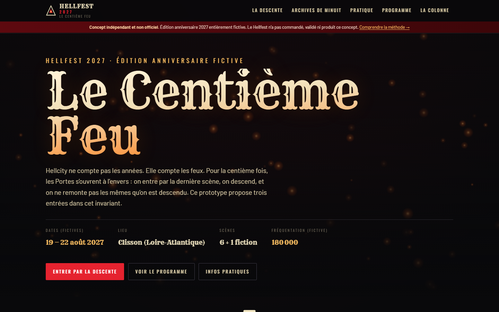

*Capture du prototype final, 27 octobre 2026, Chrome headless, 1 440 × 900 px. Bandeau
d'avertissement permanent, typographie de titre en dégradé, résumé des quatre faits de tête
(dates, lieu, scènes, fréquentation) tous marqués « fictifs », et les trois boutons d'entrée.
**Nature : capture du prototype final** — aucun équivalent préexistant.*

### 9.2 Mode A — La Descente

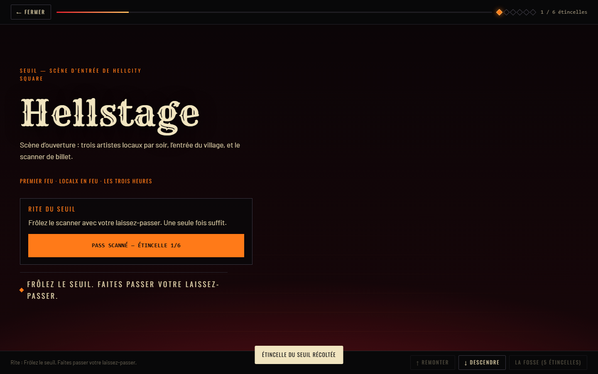

*Capture du prototype final, 27 octobre 2026. Le premier rite : présenter le laissez-passer au
scanner (clic, ou `Entrée`/`Espace` sur l'élément focalisé). La barre de progression en haut
indique « 1 / 6 étincelles » ; le compteur est une région `aria-live`. **Nature : capture du
prototype final**.*

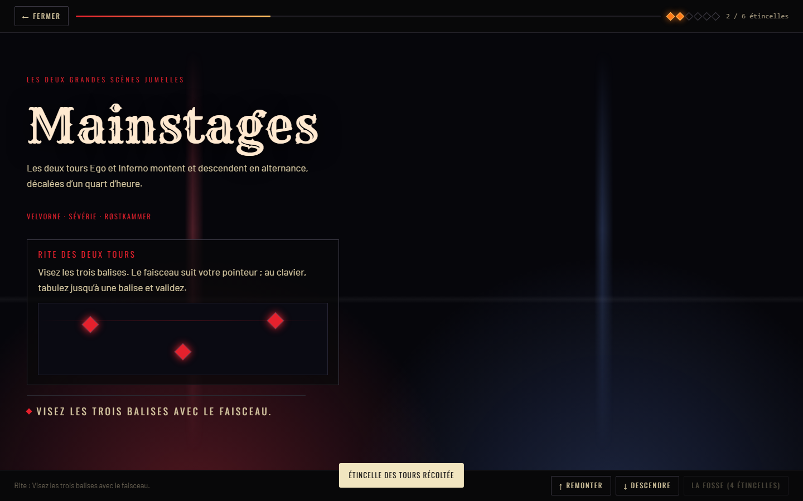

*Capture du prototype final, 27 octobre 2026. Deuxième rite : le faisceau suit le pointeur et
les trois balises s'allument. Le compteur indique « 2 / 6 étincelles ». **Nature : capture du
prototype final**.*

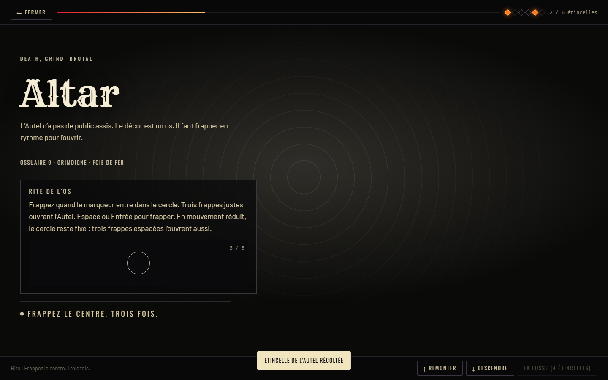

*Capture du prototype final, 27 octobre 2026, prise **au moment où le rite est accompli**
(« 3 / 3 », étincelle récoltée, notification visible). **Le marqueur mobile n'apparaît pas dans
cette image** : c'est le défaut décrit en [§8.3](#83-inachevé-ou-absent), mesuré à `left: -163 %`.
La capture montre donc un état réel du prototype, y compris son défaut. **Nature : capture du
prototype final**.*

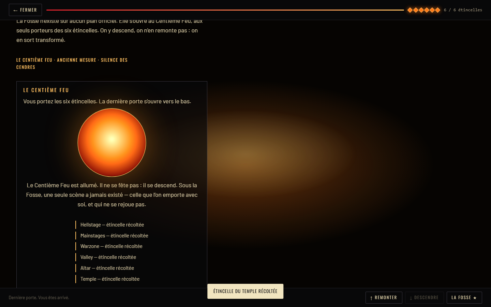

*Capture du prototype final, 27 octobre 2026, **après exécution complète des six rites**
(scanner → balises → affiches → souffle → frappe → bougies), comptée « 6 / 6 étincelles » par le
site lui-même. La Fosse affiche le récapitulatif des six scènes et le bouton « LA FOSSE ★ ».
**Nature : capture du prototype final**.*

### 9.3 Mode B — Archives de Minuit

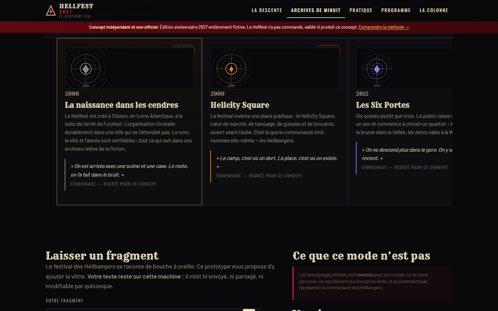

*Capture du prototype final, 27 octobre 2026. La frise horizontale des huit chapitres (2006 →
2027), chaque chapitre portant son emblème SVG généré et son étiquette « vérifié » ou « fiction ».
**Nature : capture du prototype final**.*

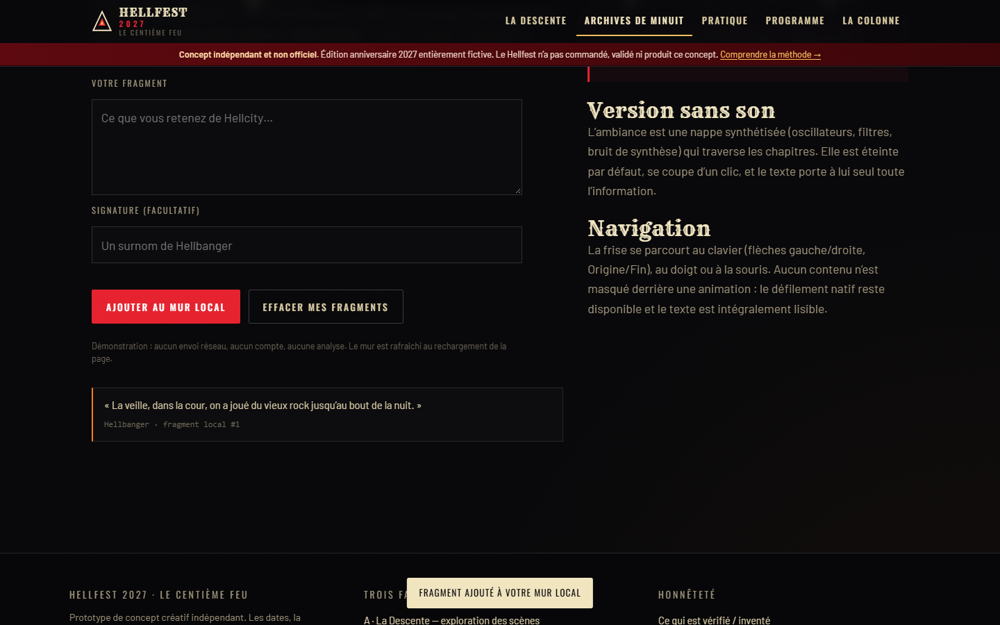

*Capture du prototype final, 27 octobre 2026, après **saisie réelle** d'un fragment dans le
formulaire (« La veille, dans la cour, on a joué du vieux rock jusqu'au bout de la nuit. »). Le
texte reste dans le navigateur : aucune requête réseau n'est émise. **Nature : capture du
prototype final**.*

### 9.4 Mode C — Pratique et programme

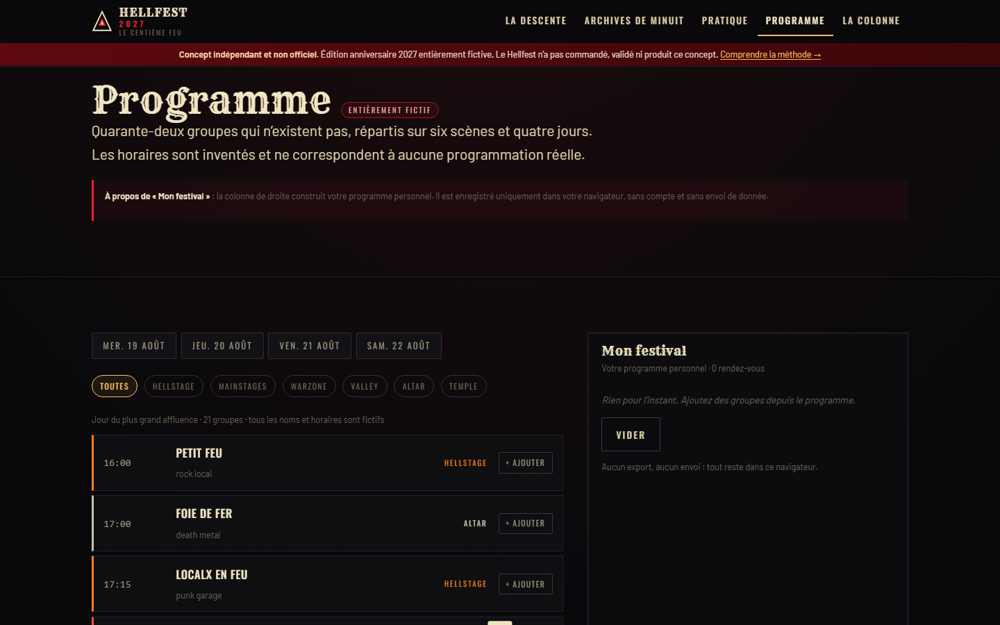

*Capture du prototype final, 27 octobre 2026, après clic sur le **troisième jour** et sur un
filtre de scène. Le bandeau « ENTIÈREMENT FICTIF » et la mention « tous les noms et horaires
sont fictifs » sont visibles ; le plan personnel « Mon festival » se lit à droite.
**Nature : capture du prototype final**.*

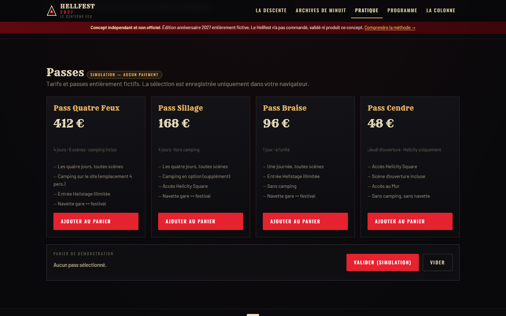

*Capture du prototype final, 27 octobre 2026. Les quatre passes portent des prix fictifs et le
panier est explicitement une démonstration : « SIMULATION — AUCUN PAIEMENT », « VALIDER
(SIMULATION) ». **Nature : capture du prototype final**.*

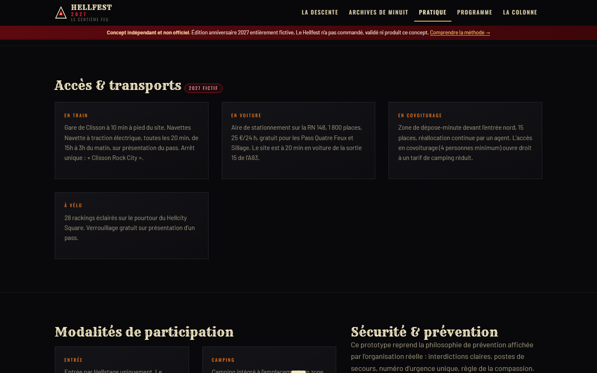

*Capture du prototype final, 27 octobre 2026. La section « Accès & transports », marquée
« 2027 fictif ». **Nature : capture du prototype final**.*

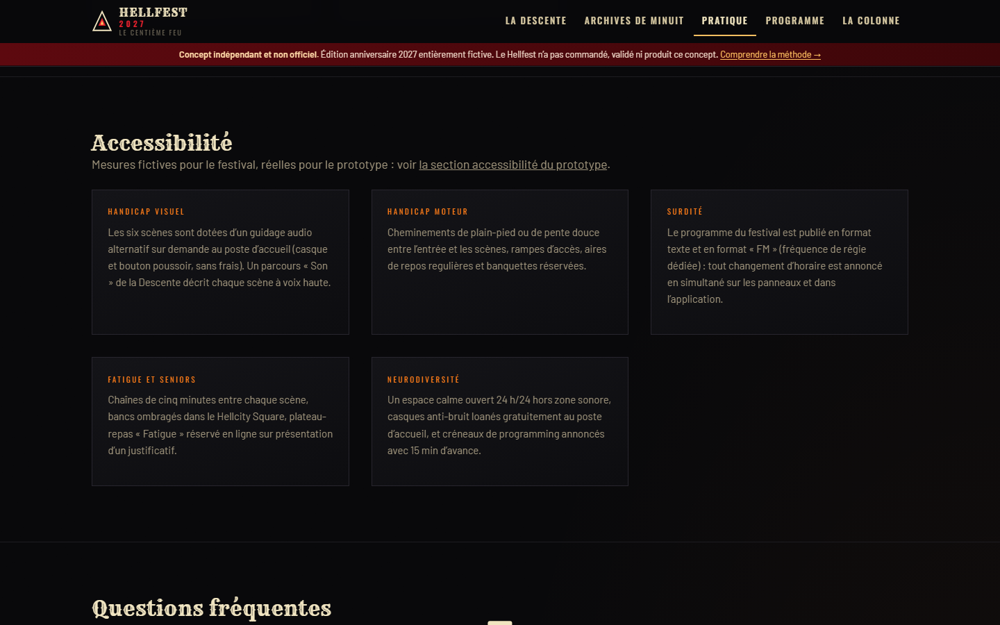

*Capture du prototype final, 27 octobre 2026. La section « Accessibilité » de l'information
pratique : ce que le prototype garantit et ce qu'il ne peut pas garantir. **Nature : capture du
prototype final**.*

### 9.5 La Colonne

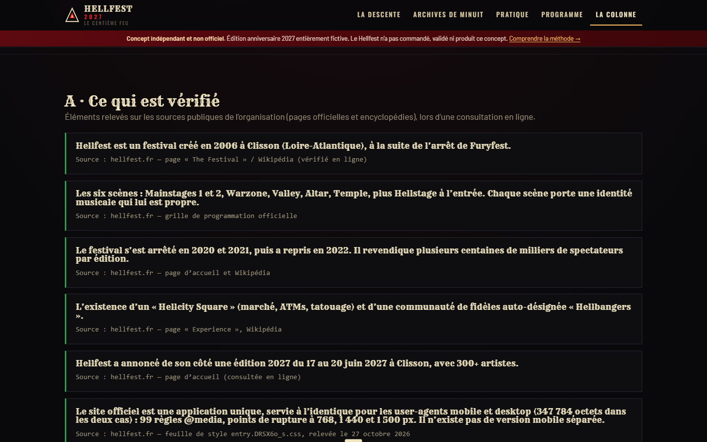

*Capture du prototype final, 27 octobre 2026. La colonne « A · Ce qui est vérifié » : six faits,
chacun avec sa source (site officiel, encyclopédie, feuille de style relevée le 27 octobre
2026). C'est la partie du produit qui assume la traçabilité. **Nature : capture du prototype
final**.*

### 9.6 Vues mobiles

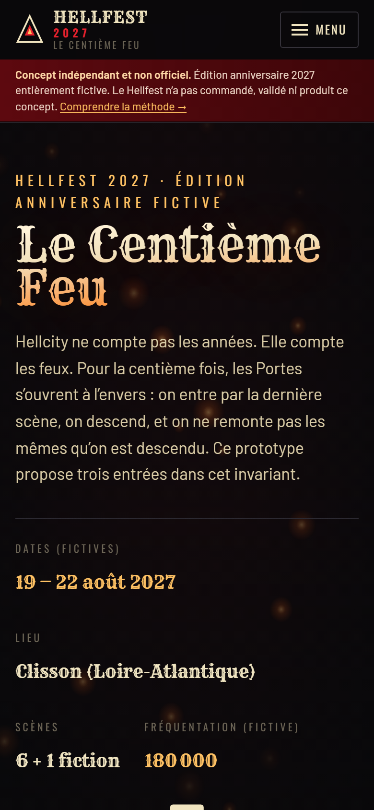

*Capture du prototype final, 27 octobre 2026, **viewport de 390 × 844 CSS px** avec
émulation tactile et facteur d'échelle 2 (image de 780 × 1 688 px). Le bouton « Menu » remplace
la navigation horizontale ; les faits de tête passent en colonne. **Nature : capture du
prototype final, format mobile réel.***

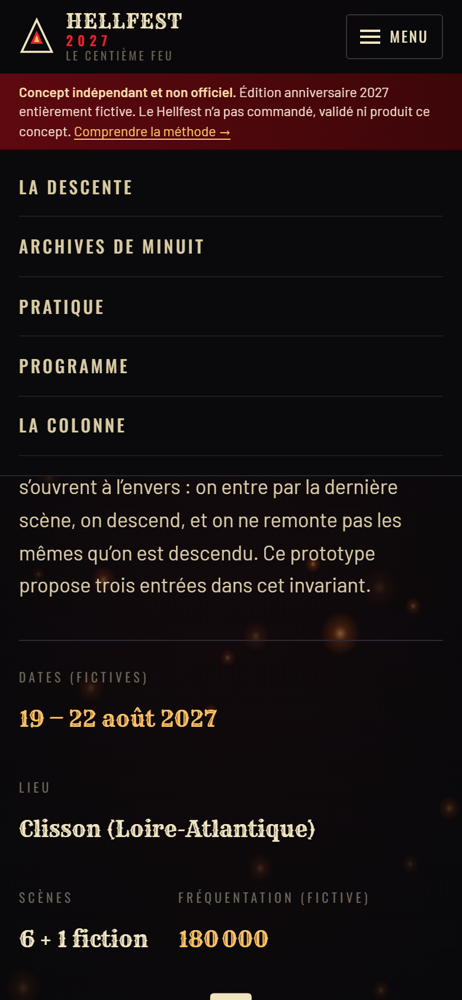

*Capture du prototype final, 27 octobre 2026, 390 px, après clic sur « Menu » : la navigation
verticale est déployée. **Nature : capture du prototype final, format mobile réel**.*

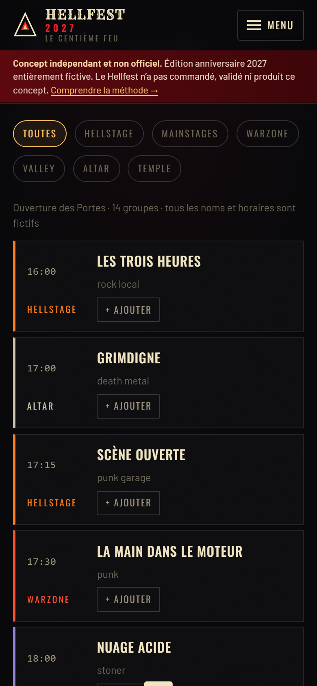

*Capture du prototype final, 27 octobre 2026, 390 px. Le programme sur écran étroit : les puces
de filtre passent à la ligne et les créneaux s'empilent (heure, titre, genre, scène, bouton
« + AJOUTER »), la colonne « Mon festival » se retrouvant sous la liste. **Nature : capture du
prototype final, format mobile réel**.*

### 9.7 Récapitulatif des visuels

| Image | Ce qu'elle montre | Étape | Nature |
|---|---|---|---|
| `01-accueil-desktop` | Accueil, 1 440 px | Après développement | Capture du prototype final |
| `02-descente-rite-seuil` | Rite du seuil | Après développement | Capture du prototype final |
| `03-descente-rite-balises` | Rite des balises | Après développement | Capture du prototype final |
| `04-descente-rite-autel` | Rite rythmique, **défaut visible** | Après développement | Capture du prototype final |
| `05-descente-fosse-finale` | La Fosse, six étincelles | Après développement | Capture du prototype final |
| `06-archives-frise` | Frise des huit chapitres | Après développement | Capture du prototype final |
| `07-archives-mur-local` | Mur local après saisie | Après développement | Capture du prototype final |
| `08-programme-filtres` | Programme filtré | Après développement | Capture du prototype final |
| `09-pratique-passes-simulees` | Passes et panier simulé | Après développement | Capture du prototype final |
| `10-pratique-acces` | Accès et transports | Après développement | Capture du prototype final |
| `11-pratique-accessibilite` | Accessibilité | Après développement | Capture du prototype final |
| `12-colonne-verifie` | Faits vérifiés et sources | Après développement | Capture du prototype final |
| `13-mobile-accueil` | Accueil mobile | Après développement | Capture du prototype final, mobile |
| `14-mobile-menu` | Menu mobile | Après développement | Capture du prototype final, mobile |
| `15-mobile-programme` | Programme mobile | Après développement | Capture du prototype final, mobile |

**Écarts entre maquettes et résultat : sans objet.** Il n'existe pas de maquette. La seule
comparaison possible est entre l'intention et le rendu final, et elle est consignée en
[§7.4](#74-décisions-importantes-et-changements-de-direction) (notamment le passage du mode B
vertical à horizontal, qui n'a été decided qu'en construisant la frise).

## 10. Technologies et structure du dépôt

### 10.1 Technologies

| Élément | Choix | Raison |
|---|---|---|
| HTML | HTML5 sémantique, un seul fichier | Aucune dépendance, aucun build |
| CSS | CSS moderne : variables, `clamp()`, `grid`, `background-clip: text`, `color-mix` | Un seul fichier, thème Piloté par variables |
| JavaScript | JavaScript **classique** (non module), IIFE par module | S'exécute sans serveur de modules ni bundler |
| Rendu | SVG en ligne, Canvas 2D (particules), CSS gradients | **Aucun** visuel externe |
| Audio | API Web Audio (oscillateurs, biquad, bruit, compresseur) | **Aucun** fichier audio |
| Stockage | `localStorage` uniquement | Pas de compte, pas de serveur |
| Routeur | Routeur par ancre (`#/route`) écrit maison | Évite le rechargement de page |
| Serveur | `serve.js`, module `http` de Node | Zéro dépendance |
| Polices | Rye, Oswald, Barlow (sous-ensembles latins) embarquées | Pas de requête vers un tiers |
| Captures | Chrome DevTools Protocol via `WebSocket` natif de Node | Zéro dépendance de capture |

**Aucune bibliothèque tierce.** Pas de framework, pas de `package.json`, pas de `node_modules`.

### 10.2 Structure

```
.
├── README.md                  ← ce document (porte d'entrée)
├── docs/
│   ├── PROCESS.md             ← journal de réalisation, tests, défauts, limites
│   ├── licenses/
│   │   └── OFL-1.1.txt        ← texte de la licence des polices embarquées
│   └── images/                ← 15 captures authentiques du prototype final
├── tools/
│   └── capture.mjs            ← script de capture CDP (reproductible)
└── hellfest-2027/             ← le prototype
    ├── index.html             ← 88 lignes
    ├── serve.js               ← 43 lignes, serveur statique
    ├── README.md              ← documentation technique du prototype
    ├── SESSION.md             ← journal de session (en anglais, annexe)
    └── assets/
        ├── css/main.css       ← 562 lignes
        ├── fonts/             ← 7 fichiers WOFF2 (Rye, Oswald, Barlow)
        └── js/
            ├── data.js        ← 262 lignes, tout le contenu éditorial
            ├── audio.js       ← 164 lignes, synthèse Web Audio
            ├── app.js         ← 667 lignes, routeur, vues, outils pratiques
            └── modes.js       ← 596 lignes, mode A (Descente) et mode B (Archives)
```

## 11. Ressources, sources et licences

### 11.1 Polices embarquées — redistribution autorisée

| Famille | Fichiers | Licence | Source |
|---|---|---|---|
| **Rye** | `rye-400.woff2` | SIL Open Font License 1.1 | <https://github.com/google/fonts/tree/main/ofl/rye> — Copyright © 2011 Sorkin Type Co, *Reserved Font Name « Rye »* |
| **Oswald** | `oswald-400/500/700.woff2` | SIL Open Font License 1.1 | <https://github.com/google/fonts/tree/main/ofl/oswald> — Copyright © 2016 The Oswald Project Authors |
| **Barlow** | `barlow-400/500/600.woff2` | SIL Open Font License 1.1 | <https://github.com/google/fonts/tree/main/ofl/barlow> — Copyright © 2017 The Barlow Project Authors |

Les trois familles sont distribuées sous **SIL OFL 1.1** (licence vérifiée dans les métadonnées
`METADATA.pb` de chaque famille). Le texte intégral de la licence se trouve dans
[`docs/licenses/OFL-1.1.txt`](docs/licenses/OFL-1.1.txt). Sous-ensembles latins uniquement,
169 Ko au total, embarqués dans le dépôt.

### 11.2 Sources consultées pour l'étude des cinq organisations

| Organisation | Nature de la consultation | Date |
|---|---|---|
| Hellfest | `hellfest.fr` — `/en`, `/en/experience-1`, FAQ, feuille `entry.DRSX6o_s.css`, PNG de logo | 27 octobre 2026 |
| Shen Yun | `shenyun.org` (redirection), communiqués officiels, JSON de FAQ, variables CSS | 27 octobre 2026 |
| Cirque du Soleil | Plan de site (217 URL), variables CSS, métadonnées de spectacles, kit de presse | 27 octobre 2026 |
| Country Jam | Récupération directe du site (contenu 2025 encore servi) | 27 octobre 2026 |
| Lollapalooza Stockholm | Site en direct (page de garde) + instantanés Wayback 2022, 2023, 2026 | 27 octobre 2026 |

Aucun visuel de ces sites n'est repris. Les seuls éléments réutilisés dans le produit sont des
**noms de lieux et de festivals**, et des faits d'histoire publique, cités avec leur source dans
« La Colonne ».

### 11.3 Ce qui n'est pas dans le dépôt

- Aucun logo, affiche, photographie, vidéo, morceau musical, slogan ou code graphique des
  organisations étudiées.
- Aucun contenu de la billetterie officielle, aucun lien de transaction.
- Aucune donnée personnelle, aucun formulaire transmettant quoi que ce soit.

## 12. Installer et lancer

### 12.1 Prérequis

- **Node.js 18 ou plus récent** (testé sur **v24.19.0**). Seul `serve.js` en a besoin ; le
  prototype lui-même est du HTML/CSS/JS statique.
- Un navigateur récent (testé sur Google Chrome, y compris en mode headless).

### 12.2 Lancer

```bash
# depuis la racine du dépôt
node hellfest-2027/serve.js
# → HELLFEST 2027 — Le Centième Feu
# → Prototype servi sur http://localhost:4177/

# ou sur un autre port
node hellfest-2027/serve.js 8080
```

Puis ouvrir **<http://localhost:4177/>**.

### 12.3 Ce qu'on peut faire sans serveur

Le site fonctionne aussi par ouverture directe de `hellfest-2027/index.html` dans un navigateur
(`file://`), **sauf** la navigation par ancre peut être affectée par les règles d'origine du
protocole `file://` selon les navigateurs : le serveur local est la méthode recommandée et testée.

### 12.4 Reproduire les captures

```bash
node hellfest-2027/serve.js 4177      # dans un terminal
node tools/capture.mjs docs/images    # dans un autre terminal
```

Le script lance un Chrome headless, exécute les interactions et réécrit les 15 images. Variables
d'environnement reconnues : `CHROME_BIN` (chemin du navigateur) et `ONLY` (filtre sur le nom des
lots, ex. `ONLY=05`).

## 13. Vérifications exécutées

Toutes les vérifications ci-dessous ont été **réellement exécutées** contre le serveur local.
La colonne « méthode » indique comment. Ce qui n'a **pas** été testé est listé en
[§13.6](#136-tests-non-effectués) — rien n'y est présenté comme ayant été fait.

### 13.1 Intégrité du build

| Vérification | Méthode | Résultat |
|---|---|---|
| Syntaxe | `node --check` sur les cinq scripts | **Réussi** |
| Caractères parasites | recherche de fragments CJK / cyrilliques dans les sources | **Aucun** restant |
| Requêtes externes | recherche d'URL absolues dans le code livré | **Seulement** l'espace de noms XML SVG (un identifiant, pas un chargement) |
| Polices | `document.fonts` | 6 des 7 faces chargées ; `Barlow:500` reste `unloaded` tant qu'aucun texte de ce poids n'apparaît (`font-display: swap`) |
| Analyse CSS | `document.styleSheets[0].cssRules.length` | **285 règles**, aucune erreur d'analyse |

### 13.2 Navigation et routage

| Vérification | Méthode | Résultat |
|---|---|---|
| Les six routes rendent | Parcours programmatique des six routes | Toutes rendent, `document.title` correct, `aria-current` correct sur les cinq entrées de navigation |
| Route par défaut | Chargement sans ancre | L'accueil rend |
| Route + ancre | `#/pratique#faq`, `#/pratique#lieux` | La page rend **et** défile vers la section, le focus est transféré |
| Ancre interne | Clic sur `#faq` dans Pratique | Défilement et focus, sans re-rendu de la vue |
| Dégagement de l'en-tête collant | Position de la cible mesurée contre le bas de `.site-head` | Les sept sections de Pratique arrivent à 128–129 px, sous l'en-tête de 114 px |
| Ancre inexistante | `#/pratique#zzz` | Aucune exception, la page reste rendue |
| Retour sur une vue | Chaque route visitée deux fois de suite | Contenu reconstruit correctement à chaque fois |
| Sortie de la Descente | Touche `Échap` | La superposition se ferme, la route revient à `#/` |

### 13.3 Les trois modes

| Vérification | Méthode | Résultat |
|---|---|---|
| Mode A — chaîne complète | Clics scriptés : scanner → 3 balises → 3 affiches → 5 respirations → 3 frappes → 5 bougies | **6/6 étincelles**, barre à 100 %, six points allumés, la Fosse se déverrouille et affiche le récapitulatif |
| Mode A — rythme hors rAF | Détection recalculée à l'instant de la frappe | 26 essais suffisent ; une variante à cible fixe sert le mode mouvement réduit |
| Mode A — verrou de la Fosse | Entrée tentée à 5 étincelles | Refusée : « Il manque 1 étincelle », le bouton reste désactivé |
| Mode A — sémantique de la progression | `aria-valuenow` sur le `role="progressbar"` | Suit le nombre d'étincelles (défaut corrigé pendant la campagne) |
| Mode A — focus de la superposition | `Tab` / `Maj+Tab` | Le focus est piégé ; `Échap` ferme |
| Mode B — structure | Requête DOM | 8 chapitres, 8 emblèmes SVG générés |
| Mode B — parcours clavier | Appuis réels sur `Fin`, `Début`, `→` | Chapitre 8 → chapitre 1 → chapitre 2, la barre suit |
| Mode B — son | Clic | `aria-pressed` bascule, le vumètre s'anime, le profil change |
| Mode B — mur local | Soumission puis effacement | Fragment stocké en `localStorage`, rendu, **aucune requête réseau** ; le bouton d'effacement est `disabled` si le mur est vide |
| Mode C — passes et panier | Clic sur des passes, validation, vidage | Total calculé, mention « simulation » présente, aucune transaction |
| Mode C — lieux | Requête DOM | Dix lieux fictifs rendus |
| Programme — jours et filtres | Clic sur chaque jour puis chaque scène | 14 / 18 / 21 / 15 créneaux par jour (68 au total) ; le filtre réduit à 2–3 créneaux ; la ligne d'information se met à jour |
| Programme — plan personnel | Clic « ajouter », puis « Vider » | Élément listé, compteur à jour, persisté localement, vidé à la demande |
| Colonne — préférences | Clic sur réduit / contraste / son | `data-reduced="1"`, `data-contrast="1"`, son respecté et persisté |

### 13.4 Accessibilité

| Vérification | Méthode | Résultat |
|---|---|---|
| Noms accessibles | Balayage de tous les `button` et `a[href]` | Aucun bouton ni lien sans nom accessible |
| Images et SVG | Balayage de `img[alt]` et des SVG non étiquetés | 0 image sans `alt`, 0 SVG non étiqueté |
| État des bascules | Balayage de tous les `aria-pressed` | Présent et correct sur les puces, les boutons de passes, le plan personnel et les réglages de confort |
| Régions vivantes | Balayage de `role="status"` / `aria-live` | Compteur de progression et notification sont des régions polies |
| Lien d'évitement | Focus programmatique | Masqué hors écran (−69 px) jusqu'au focus, puis fully visible en haut avec un contour de 3 px |
| Visibilité du focus | Appui réel sur `Tab` | Contour ambre plein de 3 px, décalage 3 px |
| Mouvement réduit | Bascule du réglage applicatif | `data-reduced="1"`, transitions réduites à 0,000001 s, le rite rythmique passe en variante fixe et se termine |
| Taille des cibles tactiles | Mesure à 390 px | Balises agrandies de 16 px à 22 px (défaut corrigé : 23 × 23 px effectifs, sous le minimum de 24 px) |
| Navigation mobile | Iframe à 390 px | Le bouton apparaît, s'ouvre, met `aria-expanded` et `aria-label` à jour, se referme à l'activation d'un lien |

### 13.5 Mise en page et santé

| Vérification | Méthode | Résultat |
|---|---|---|
| Débordement horizontal | Banc d'essai en iframe à 390 / 768 / 1 440 px sur cinq routes | **Aucun débordement** au niveau de la page. Les seuls éléments plus larges que la fenêtre sont la piste horizontale de `.arch-scroll`, qui est un conteneur de défilement par construction |
| Santé de la console | `window.onerror` + capture `console.error`/`warn` sur tout le parcours | **0 erreur, 0 avertissement** |
| Audit des boutons morts | Clic sur chaque bouton de chaque vue, comparaison d'une signature d'état avant/après | 0 bouton mort. Les deux seuls non réactifs sont conditionnellement inertes : le bouton d'envoi est bloqué par la validation native quand le champ est vide, et le bouton d'effacement est explicitement `disabled` sur un mur vide |
| Isolation des événements | Clic sur une balise quand le programme n'est pas monté | Aucun gestionnaire d'une autre vue ne se déclenche (défaut corrigé) |
| Revue visuelle | Captures Chrome headless, 15 images relues à l'œil | **Effectuée pendant cette passe de documentation.** Première revue visuelle possible du projet. Elle a mis au jour le défaut du marqueur de l'Autel ([§8.3](#83-inachevé-ou-absent)) |

### 13.6 Tests non effectués

- Rendu sur **téléphone ou tablette physique**.
- Rendu dans **Safari, Firefox ou Edge** (le prototype n'a été observé que dans Chromium/Chrome).
- **Sortie réelle d'un lecteur d'écran** : seule la structure ARIA a été contrôlée.
- **Écoute réelle du son** : le graphe Web Audio a été vérifié par son état, pas à l'oreille.
- **Comparaison visuelle du rendu officiel** de Hellfest sur mobile et desktop : la comparaison
  reste structurelle.
- **Audit de sécurité**, **tests de charge**, **tests de compatibilité** d'anciens navigateurs.
- Le **prototype n'a pas été publié** et n'a donc jamais été servi hors de la machine locale.

## 14. Contexte de réalisation

| Élément | Valeur |
|---|---|
| Modèle | **MiniMax-M3.1-Flash** (MiniMax), knowledge cutoff **février 2026** |
| Runtime | Qoder Desktop (agent), win32 build `10.0.26300`, x64 |
| Système | Windows 11, build 10.0.26300 |
| Coquille | Git Bash (`C:\Program Files\Git\bin\bash.exe`) |
| Node.js | **v24.19.0** (aucun paquet installé, aucun `node_modules`) |
| Python | 3.13 — utilisé uniquement comme utilitaire de traitement de texte sur les sources |
| Accès réseau | Oui, pour la recherche (cinq sites), les polices (Google Fonts), les archives Wayback et la vérification des licences |
| Navigateur de vérification | Google Chrome **headless** (CDP), viewport 390 → 1 440 px, émulation tactile activée pour les formats mobiles |
| Services payants / API | **Aucun.** Aucune clé, aucun compte, aucune facturation |
| **Consommation de tokens** | **Non mesurable par l'agent.** Le runtime n'expose aucun compteur fiable ; aucune valeur n'est donc affirmée plutôt qu'inventée |
| **Coût monétaire** | **Aucun coût direct** — aucun service payant, aucune clé d'API. Le coût interne d'inférence n'est pas mesurable ici et n'est pas estimé |

### 14.1 Durée mesurée

| Phase | Mesure |
|---|---|
| Première production de fichier (polices embarquées) | 2026-10-27 **17:40:52** |
| Build final (prototype + documentation technique) | 2026-10-27 **18:16:17** |
| **Fenêtre mesurée build → tests → finitions** | **35 min 25 s** |
| Phase de recherche (avant la première production) | Non mesurable indépendamment ; le début de session est placé à ≈ 17:33, ce qui porte le **total à ≈ 43 minutes** |
| Passe de documentation (captures + ce README) | Commencée après la fin de la session de construction (18:16:17), première capture à 18:37, dernière écriture de la documentation à 18:46 — **≈ 30 min**, dont ≈ 12 min de captures automatisées |

La demande de documentation elle-même a été reçue à **18:10**, alors que la session de
construction se terminait (dernier fichier écrit à 18:16:17). **Aucun fichier du prototype
n'a été modifié après cette date** : les horodatages montrent que `hellfest-2027/` est
intact, et que la passe de documentation n'a produit que `docs/`, `tools/` et ce README.

La limite de 90 minutes du brief n'a pas été atteinte ; il n'existe pas de coupure automatique
dans cet environnement, l'arrêt relève de la décision de l'agent.

## 15. Bilan honnête

### Ce qui tient

- **Le choix et sa justification** sont adossés à une consultation réelle des cinq sites, avec
  sources et date, et la séparation faits / interprétations / inaccessibles est tenue jusque dans
  le produit lui-même (« La Colonne »).
- **L'indépendance vis-à-vis des assets protégés** est totale : aucun logo, affiche, photo, vidéo,
  musique ou code graphique emprunté. Tout le graphisme est procédural, donc redistribuable.
- **Le prototype est réellement lançable** et sans dépendance : une commande, six routes, trois
  modes cohérents.
- **Le respect du brief sur les interdits** est vérifiable : aucune transaction, aucune donnée
  personnelle, aucune collecte, aucun partenariat inventé, un avertissement non officiel permanent.
- **L'accessibilité** n'est pas un ajout de façade : 20 contrôles documentés, dont la taille des
  cibles tactiles, le piégeage de focus, le mouvement réduit et l'absence de sons supposés.
- **Les captures sont authentiques** et reproductibles : le script qui les produit est dans le dépôt.

### Ce qui ne tient pas encore

- **Aucune maquette, aucun croquis, aucun moodboard** n'a été produit avant le développement. Le
  concept a existé d'abord comme structure de code. C'est le point faible le plus net du dossier
  au regard d'une exigence de « parcours de conception ».
- **Le rite rythmique est visuellement cassé** : le marqueur est rendu hors de la piste
  (`left: -163 %`). Le jeu reste juste, l'image ne l'est pas. Corrigible en une ligne
  (`Date.now()` au lieu de l'horodatage rAF dans `modes.js`), mais **non corrigé**, la consigne de
  cette passe étant de ne pas modifier le prototype.
- **La revue visuelle n'a existé qu'à la toute fin.** Les contrôles précédents étaient
  géométriques et structurels ; une anomalie d'affichage a donc pu subsister jusqu'à la dernière
  image — ce que la capture de l'Autel a effectivement montré.
- **Un seul navigateur, un seul format d'appareil.** Rien n'a été vérifié sur Safari, Firefox,
  Edge, ni sur un écran réel.
- **Les chiffres du festival sont inventés** et clairement marqués comme tels ; ils n'ont aucune
  valeur documentaire.

### Améliorations possibles, par ordre de rendement

1. Corriger l'horloge du marqueur de l'Autel et rejouer la capture correspondante.
2. Refaire la campagne de captures sur **Firefox** et **Safari** (macOS et iOS), et sur un
   téléphone réel.
3. Ajouter un **test de non-régression** sur le rendu du marqueur (position dans la piste) et
   sur la largeur des cibles tactiles — ce sont les deux classes de défaut que la revue visuelle
   a révélées et que les contrôles programmatiques ne couvraient pas.
4. Produire **un esquisse de parcours avant développement** (neuf écrans, trois modes), même
   tardivement, pour documenter l'intention — en le présentant comme ce qu'il est, et non comme
   une preuve d'un travail préalable qui n'a pas eu lieu.
5. Ajouter un **export du programme personnel** en fichier local, et un export des fragments.
6. Documenter un **budget de performance** (poids total, requêtes, temps de premier rendu mesuré)
   qui est aujourd'hui absent.

---

### Annexes

- [`docs/PROCESS.md`](docs/PROCESS.md) — journal de réalisation détaillé : recherche
  candidat par candidat, décisions, architecture, journal de vérification complet, defects et
  limites.
- [`hellfest-2027/README.md`](hellfest-2027/README.md) — documentation technique du prototype.
- [`hellfest-2027/SESSION.md`](hellfest-2027/SESSION.md) — journal de session de la phase de
  construction (en anglais, conformément à la convention du projet : le contenu produit reste
  en français, les journaux d'expérience en anglais). *Une phrase y est devenue caduque depuis :*
  il y est écrit qu'aucune revue visuelle n'avait pu être faite — c'était exact pendant cette
  session, et faux depuis la passe de documentation du 27 octobre 2026 qui a produit les captures
  de `docs/images/`.
- [`tools/capture.mjs`](tools/capture.mjs) — script de capture des visuels.
